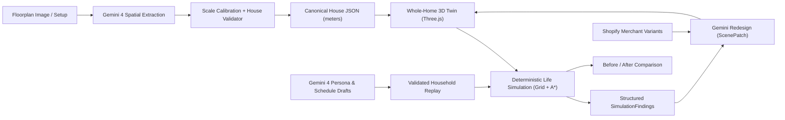

# Your Room

> **Your Room is a household digital twin that tests how people will actually live inside a home before they move in or buy the furniture.**
>
> *Will your life fit?*

---

## What It Does

**Your Room** turns a floorplan or room setup into a structured, walkable **whole-home 3D digital twin**, populates it with **household member personas and daily schedules**, and runs **deterministic spatial simulations** to catch real living friction—blocked walkways, hallway collisions, kitchen congestion, noise/privacy conflicts, and egress bottlenecks—before you sign a lease or buy furniture.

When simulation validators surface measurable problems, Gemini 4 reasons over the structured evidence to propose layout improvements (`ScenePatch` + source-backed Shopify furniture options) that can be re-simulated on the exact same household routine to prove **Before → After** gains.

---

## Why It Is Different

| Traditional Interior Tools | Your Room (Household Digital Twin) |
| :--- | :--- |
| Visualize whether a sofa fits inside one static room. | Simulate whether an entire household's daily life fits across the whole home. |
| Single-room decorative staging. | Connected multi-room geometry (`rooms`, `walls`, `doors`, `windows`, `locked fixtures`). |
| Static camera renders. | Schedule-driven movement, A* navigation, and first-person `W/A/S/D` + 360° Orbit. |
| "Looks nice" judged subjectively or by an LLM prompt. | **AI reasons, deterministic validators decide** (clearance, collisions, congestion, reachability). |
| One-shot AI layout replacement that moves plumbing or walls. | Controlled edits that strictly respect `locked: true` walls, toilets, sinks, counters, and stoves. |

---

## Demo Flow

```text
1. Floorplan Input       → Upload a floorplan image (or load the bundled Mercer Street Apartment)
2. Gemini 4 Extraction   → Structured rooms, doors, windows, fixtures + printed-scale or 2-point calibration
3. Whole-Home 3D Twin    → Explore connected rooms via 360° Orbit or first-person W/A/S/D walking
4. Household Personas    → Generate or edit members, preferences, fixed routines, and flexible windows
5. Simulate Life         → Run Morning Routine / Stress Scenarios to measure paths, collisions & congestion
6. Redesign & Replay     → Apply layout changes while preserving locked fixtures, then replay Before / After
7. Shop Real Pieces      → Save source-backed Shopify merchant variants to the shopping list
```

---

## Architecture

> **Core Principle:** *Gemini interprets ambiguity and proposes changes; deterministic geometry and simulation engines decide `PASS / FAIL`.*



### Repository Implementation Status

| Capability | Status | Key Modules |
| :--- | :--- | :--- |
| Single-room studio, local COCO-SSD photo intake, 2D non-WebGL fallback, Shopify variant shopping list | **Implemented (`main`)** | `app.js`, `setup.js`, `model.js`, `scene.js`, `detection.js`, `offers.json` |
| Gemini 4 household persona generation, fixed & flexible schedule resolver, guest profiles, layout comparison harness | **Implemented (`main`)** | `src/agents/persona-api.js`, `src/contracts/persona.js`, `src/persona/resolve-schedule.js`, `src/persona/compare-household-layouts.js` |
| Gemini 4 floorplan extraction, printed-scale & 2-point manual calibration, deterministic `House` validator | **Implemented (`feat/floorplan-importer`, in integration)** | `src/spatial/floorplan-importer.js`, `src/spatial/floorplan-ai-adapter.js`, `src/lib/validators/house-validator.js` |
| Whole-home 3D renderer, 360° Orbit cutaway, first-person `W/A/S/D` room-to-room navigation, locked 3D fixtures | **Implemented (`feat/whole-home-scene`, in integration)** | `house-model.js`, `house-demo.js`, `scene-architecture.js`, `scene-furniture.js` |
| Navigation grid, A* pathfinding, schedule movement, personal-space collision & congestion engine | **Implemented (`feat/life-simulation-core`, in integration)** | `src/simulation/navigation-grid.js`, `src/simulation/pathfinding.js`, `src/simulation/simulation-engine.js` |
| Simulation control panel, scenario selector, findings cards, scorecard, Before/After UI shell | **Implemented (`feat/demo-controls-ui`, in integration)** | `src/components/simulation/demo-controls.js`, `src/contracts/simulation.js` |
| End-to-end live simulation binding, extended stress validators (party/egress/noise/glare), automated `ScenePatch` redesign loop & live Shopify search | **Planned for final demo integration** | Cross-branch integration track |

---

## Gemini 4

Gemini 4 is used where **multimodal understanding and structured semantic reasoning** are essential—never as a substitute for spatial math:

1. **Floorplan Spatial Understanding (`src/spatial/floorplan-ai-adapter.js`)**: Extracts room polygons, door connections (`interior` / `exterior`), exterior windows, fixed bathroom/kitchen fixtures, and printed dimension strings under a strict JSON schema (`gemini-4-carbon` with automatic fallback).
   - **Verified Live Test A (Unseen Dimensioned Floorplan)**: Identified 4 rooms, 4 doors, 3 windows, and 7 locked fixed fixtures; interpreted printed dimensions to compute physical meter scale and pass deterministic `House` validation.
   - **Verified Live Test B (Unseen L-Shaped Unscaled Floorplan)**: Extracted non-rectangular room geometry without fabricating a fake scale; the importer flagged `calibrationRequired: true`, applied interactive two-point distance calibration, and passed deterministic validation.
2. **Household Persona & Schedule Generation (`src/agents/persona-api.js`)**: Converts natural-language household descriptions (e.g., *"Alex works from home from 9 to 5. Sam watches TV from 4 to 5."*) into schema-constrained `Persona[]` profiles with quantified needs (`privacy`, `quiet`, `accessibility`, `daylight`, `social`), fixed intervals, and flexible time windows.
3. **Evidence-Driven Redesign (`Planned for final demo`)**: Consumes measured `SimulationFinding[]` records to propose `ScenePatch` operations (`move`, `rotate`, `replace`, `add`, `remove`) without touching `locked: true` architecture or fixtures.

---

## Deterministic Verification

An LLM never grades its own homework. Every AI output passes through deterministic application code:

```text
Gemini Proposes  ──►  Deterministic Engine Measures  ──►  PASS / FAIL
```

- **Architectural & Scale Validation**: Rejects self-intersecting or zero-area polygons, duplicate IDs, dangling door/room references, off-wall windows, uncalibrated pixel coordinates, and unlocked fixed fixtures.
- **Locked Fixture Immutability**: Walls, toilets, sinks, bathtubs, kitchen counters, stoves, refrigerators, and AC units carry `locked: true` and deterministically reject automated move/rotate/remove/replace operations.
- **Schedule & Replay Determinism**: Fixed activities reserve time first; flexible windows resolve deterministically; `compareHouseholdLayouts` replays identical schedules before and after layout edits.
- **Grid Navigation, A* & Congestion Evidence** (*deterministic sample scenario output on the bundled Mercer Street Apartment `Morning Routine` 07:00–09:00*):
  - **Kevin**: `~30.0 m` total movement across bedroom, bathroom, hallway, kitchen, and workspace
  - **Alice**: `~22.5 m` total movement across bedroom, bathroom, kitchen, and exit
  - **Path failures**: `0`
  - **Agent collisions**: `2` (narrow hallway crossing)
  - **Kitchen congestion**: `1` measured event (`2` agents overlapping for `~1498 s`, minimum clearance `~0.11 m`)

---

## Shopify / Commerce

- Placed catalog suggestions are separated from pre-existing owned furniture and locked architectural fixtures (`getSpend` excludes owned and locked items).
- `offers.json` provides source-backed Shopify merchant variant URLs, product imagery, store names, and USD prices captured on November 21, 2026 (3D meshes and dimensions in the local catalog are marked as approximations; merchants confirm live stock and pricing at checkout).
- Live Shopify storefront search and expanded `ProductCandidate` replacement flows are part of the commerce integration track.

---

## Running Locally

Requires **Node.js 22.12+**.

```bash
npm ci
npm run dev
```

Open the local URL printed by Vite (default dev workflow binds to `127.0.0.1`). Both sample single-room and sample whole-home flows run locally even without an API key.

To preview the production bundle with local server API middlewares active:

```bash
npm run build
npm exec -- vite preview --host 127.0.0.1
```

---

## Environment Variables

Copy `.env.example` to `.env.local` and set your Gemini API key:

```bash
cp .env.example .env.local
```

```ini
GEMINI_API_KEY=
```

- **Security & Deployment Note**: Live Gemini calls (household persona generation and `/api/floorplan/analyze` floorplan extraction) execute through local server-side Vite middlewares (`vite.config.js`) so `GEMINI_API_KEY` is never exposed to browser bundles. A purely static host will serve the deterministic sample rooms/floorplans and client-side 3D studio, while live Gemini endpoints require a Node/serverless backend route in production deployment.

---

## Tests

```bash
npm test          # Node unit, contract, schedule, geometry & API tests (no API key required)
npm run test:e2e  # Playwright Chromium end-to-end browser flows
npm run build     # Production Vite bundle verification
```

---

## Team

Built for the **Gemini 4 NYC Hackathon**:

- **Kevin** — Spatial Digital Twin, Floorplan Calibration & Geometry Validation, Whole-Home 3D Renderer, Navigation Grid, A* Pathfinding & Deterministic Simulation
- **Hank Lin** — Gemini 4 Agent Workflows, Household Personas & Flexible Schedules, Redesign Reasoning (`ScenePatch`) & Shopify Commerce

---

## Known Limitations

- Single-photo room capture estimates approximate furniture positions and representative meshes rather than LiDAR depth.
- Acoustic, daylight/glare, and emergency egress checks are deterministic **layout stress tests and geometric approximations**, not certified structural, acoustic, or fire-safety engineering tools.
- While cross-branch integration is finalized, the Demo Controls UI shell displays explicitly badged `Demo mock` preview metrics whenever an external simulation engine is not attached.

[Asset credits](public/assets/CREDITS.md)
