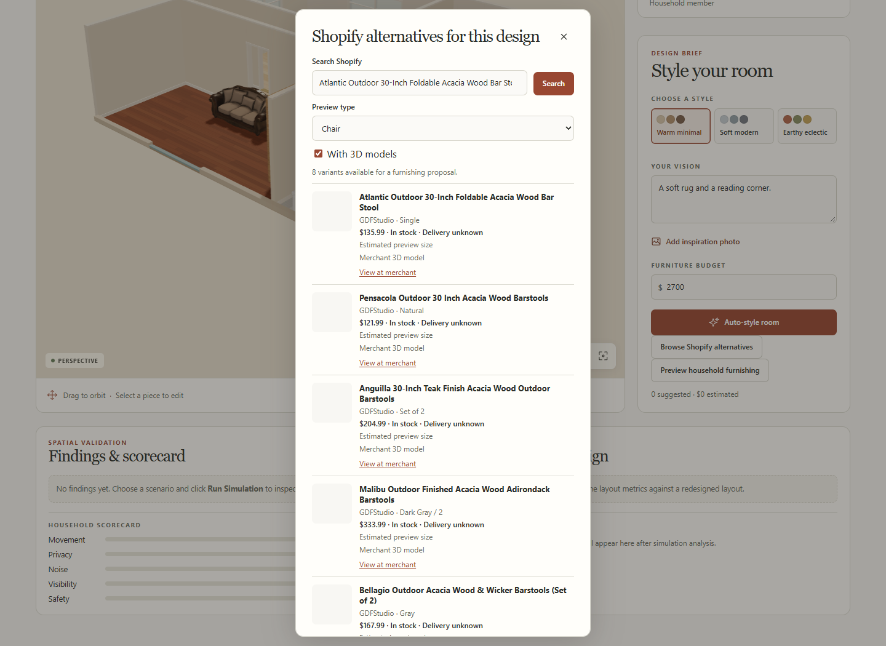
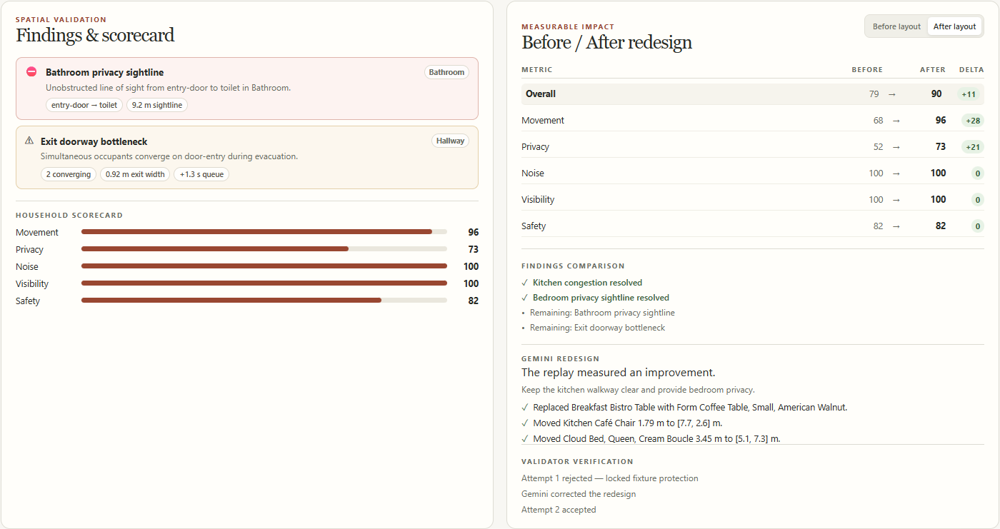
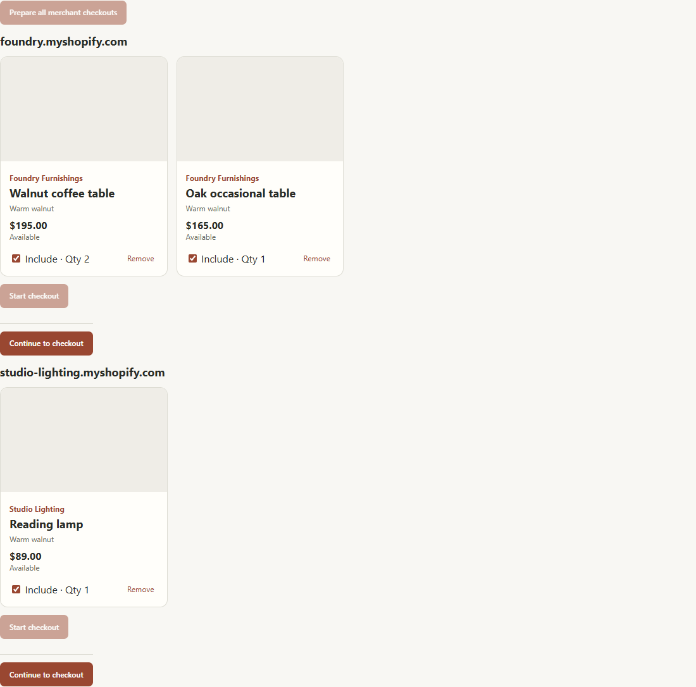

# Whole-home demo acceptance

This maps the 「步驟」 section of the [Hackathon idea brief](https://docs.google.com/document/d/17mqughSaghJRQH1NwVg86Ux1c8ouHhj6iHOxLKPXLtg/edit?tab=t.0) to the combined Living Blueprint demo. Run `npm ci` and `npm run dev` from the repository root.

| Brief step | Demo and expected evidence | Reproducible coverage |
| --- | --- | --- |
| 生成空房子/房間 | Try the sample floor plan, review the extracted layout and confirm import. Walk between rooms using WASD and switch to Orbit. Movable pieces rotate. Doors, walls and fixtures retain their geometry, and a locked fixture rejects attempted changes. | `e2e/floorplan-importer.spec.js`, `e2e/whole-home.spec.js` |
| 建立小人 persona | In Household, generate a draft, load the sample or use **Import from your agent**. Paste or upload JSON, reassign an unknown room, review fixed and flexible activities and save. Invalid JSON preserves the current draft. | `e2e/household.spec.js`, `e2e/persona-import.spec.js` |
| 設計房子，根據 persona and 喜歡風格/照片 | Save a household, select a style, add a reference photo and budget, and request a furnishing proposal. Each proposed addition names a person and need. Approval preserves existing pieces. Invalid placements, stale proposals and over-budget changes are rejected. | `src/persona/furnishing.test.js`, `e2e/furnishing.spec.js` |
| 可以使用原本自己的老家具 | In Room setup, upload a room or furniture photo, review the detected owned piece and its estimated dimensions, then explore it in 3D. Detection uses the photo for appearance and footprint. Depth and hidden geometry are estimated. Manual entry is available when detection fails. | `e2e/studio.spec.js`, `model.test.js` |
| 使用 Shopify 上的商品 | From Design, browse two matching alternatives and request a proposal. From Studio, Add or Swap also accepts a live variant. Approve a choice to adopt the merchant identity, dimensions and model. Unused products stay in the shortlist. A changed offer requires review, and missing delivery stays unknown. Merchant-specific GLBs render where supplied, with a furniture-type fallback. | `src/shopify/live-candidates.test.js`, `e2e/live-shopify-candidates.spec.js`, `e2e/shopify.spec.js` |
| 模擬出房子 | In Explore room, inspect the home in first person, Orbit or overhead. Use **Find address**, enter a U.S. address, UTC time and the plan’s compass bearing. Compare morning and afternoon sun direction. Comparisons retain the original environment snapshot. Missing weather or orientation is identified in the panel. | `e2e/whole-home.spec.js`, `e2e/environment.spec.js`, `src/environment/environment.test.js`, `redesign-replay.test.js` |
| 編輯房子 | Use **Try blocked-route replay demo → Save and continue → Explore room → Capture baseline**. Choose **Edit a selected area**, draw around the Bedroom sofa or choose Bedroom, enter a doorway-clearance instruction and preview the ScenePatch. Approval moves the sofa, reruns the approved schedule and records one undoable edit. A locked, out-of-region or stale move is rejected. | `e2e/studio-replay.spec.js`, `src/agents/replay-suggestion.test.js` |
| 小人模擬生活、壓力測試 | In the sample whole home, run **Morning Routine**, **Dinner Party** with eight guests, or **Fire Emergency**. Follow 3D avatars and routes, inspect blockages and congestion, and review evacuation paths. The findings identify household members when the measurement identifies them. | `e2e/simulation-playback.spec.js`, `e2e/twin-golden-path.spec.js`, `life-simulation.test.js` |
| 物理部分、使用者抉擇是否再依此修改房間布局 | Inspect TV occlusion, viewing angle and apparent screen width, privacy sightlines, WFH/TV noise or glare. Generate a redesign, review the proposed actions, approve and toggle Before/After. Measurements drive the result, including unchanged or worse layouts. Simulated noise, sightlines and glare are approximations. | `spatial-validators.test.js`, `redesign-replay.test.js`, `e2e/demo-controls.spec.js`, `e2e/studio-replay.spec.js` |
| 購買佈件 → 可以全屋結帳 | Save the room, select variants and quantities, then use checkout for all selected merchants. Two items from one merchant share one checkout. A second merchant receives its own checkout. Repricing, stock loss or failure blocks the affected handoff. | `src/shopify/shopify-api.test.js`, `e2e/shopify.spec.js`, `e2e/integrated-shopify.spec.js` |

The sample floor plan and mocked provider responses make these demos repeatable offline after dependencies and bundled assets are installed. Live Gemini generation needs the server-side `GEMINI_API_KEY`. Live Shopify discovery, U.S. geocoding and weather need network access. Product media, dimensions and delivery depend on the source. Personal-agent import accepts a user-supplied export. A single photograph supplies an approximate owned-furniture preview, and the brief leaves the reconstruction method open.

## Live Shopify example

A models-only search on November 21, 2026 returned eight alternatives. Refreshing the Atlantic Outdoor 30-Inch Foldable Acacia Wood Bar Stool confirmed merchant `great-deal-furniture.myshopify.com`, variant `231662438` (Single), in stock at US$135.99. Delivery was unknown. The merchant served a 592,840-byte glTF 2.0 model. These are point-in-time observations. The [Shopify verification guide](../README.md#shopify-verification) includes the repeatable checkout assertions and test commands.

## Measured redesign and grouped checkout

In a sample-home Chrome run, the first Gemini fixture tried to move a locked toilet. Spatial validation rejected it. Dismissing the corrected preview, or refreshing its chosen variant after stock ran out, left the entire saved project unchanged. After stock was restored, the approved redesign improved the measured overall score from 79 to 90, movement from 68 to 96 and privacy from 52 to 73. The bathroom sightline and exit bottleneck remained visible. The simulator, renderer, persistence and checkout adapter ran locally with controlled provider responses.

The two-merchant fixture checked the actual outgoing lines. One merchant received variant 97001 at quantity two and 97002 at quantity one. A second merchant received variant 98003 at quantity one. Each merchant returned a separate checkout link.

